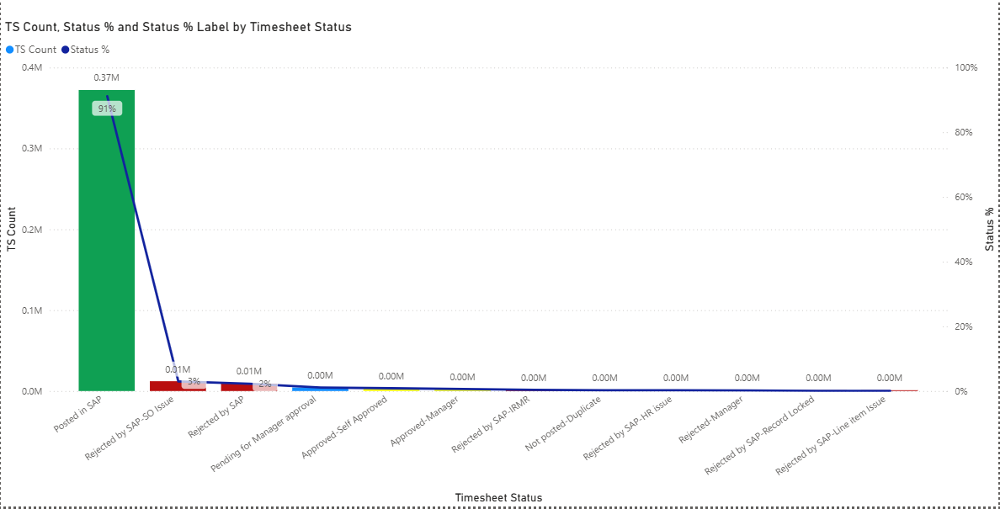
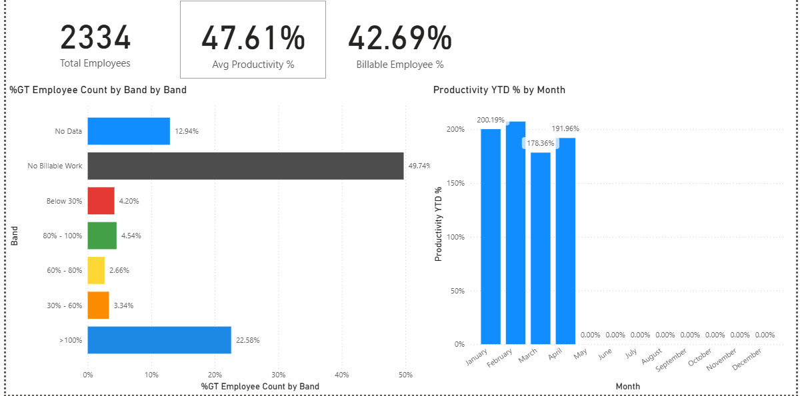

# Power BI Dashboard Portfolio

Welcome to my Power BI Dashboard Portfolio. This repository showcases selected dashboard visuals demonstrating my experience in business intelligence, KPI reporting, data visualization, and productivity analytics.

## 1. Timesheet Productivity Dashboard

This dashboard visualizes timesheet processing status, record counts, and status percentages across different workflow stages.

## 2. Workforce Productivity Dashboard

This dashboard presents workforce productivity indicators, including employee count, average productivity, billable employee percentage, employee distribution by productivity band, and monthly productivity trends.

## Skills Demonstrated

- Power BI report design and data visualization
- KPI cards and performance indicators
- Productivity and timesheet analytics
- Monthly trend analysis
- Status distribution and percentage reporting

## About This Repository

This repository contains selected dashboard screenshots for portfolio demonstration. It does not include the underlying Power BI files, datasets, or implementation code.

**Author:** Soeb Diwan
